```mermaid
flowchart LR
  A["arXiv API or existing JSON"] --> B["paper_chroma.py"]
  B --> C["Chroma raw_papers"]
  C --> D["nountotokenclean_chroma.py"]
  D --> E["SpaCy NLP cleaning"]
  E --> F["all-MiniLM-L6-v2 embeddings"]
  F --> G["Chroma processed_papers"]
  G --> H["search_engine_chroma.py"]
  H --> I["Vector retrieval"]
  I --> J["Hybrid reranking"]
  J --> K["CLI/API results"]
```

# ChromaDB Version

This is the production ChromaDB backend for the **AI Scientific Paper Knowledge Engine**. The MongoDB implementation remains in `mongo_version/` as the rollback version.

## Architecture



## Files

| File | Purpose |
| --- | --- |
| `chroma_config.py` | Persistent Chroma client and collection configuration. |
| `embedding_service.py` | `all-MiniLM-L6-v2` embedding model wrapper. |
| `collection_manager.py` | Chroma schema, metadata, batching, upserts, status helpers. |
| `paper_chroma.py` | arXiv ingestion into `raw_papers`. |
| `nountotokenclean_chroma.py` | SpaCy cleaning plus processed Chroma storage. |
| `ranking_service.py` | Abbreviation extraction and hybrid reranking. |
| `search_engine_chroma.py` | CLI search plus paper/related retrieval helpers. |
| `api_service.py` | FastAPI backend endpoints. |

## Environment Variables

```env
CHROMA_DB_PATH=./chroma_db
CHROMA_RAW_COLLECTION=raw_papers
CHROMA_PROCESSED_COLLECTION=processed_papers
CHROMA_ABBREVIATION_COLLECTION=abbreviations
EMBEDDING_MODEL=sentence-transformers/all-MiniLM-L6-v2
```

## Chroma Schema

**Raw collection: `raw_papers`**
- `id`: stable arXiv ID
- `document`: title, abstract, URL
- `embedding`: zero vector (source storage only)
- `metadata`: original paper fields plus `paper_id`, `ingested_at`, `schema_version`

**Processed collection: `processed_papers`**
- `id`: stable arXiv ID
- `document`: title, abstract, cleaned keywords, important phrases, categories
- `embedding`: `all-MiniLM-L6-v2` vector for the combined searchable document
- `metadata`: `title`, `abstract`, `url`, `published`, `updated`, `cleaned_keywords`, `important_phrases`, and preserved source fields

## API Endpoints

| Method | Endpoint | Purpose |
| --- | --- | --- |
| `POST` | `/search` | Vector search plus lexical reranking. |
| `GET` | `/paper/{id}` | Fetch a processed paper. |
| `GET` | `/papers` | Paginated paper listing. |
| `GET` | `/related/{id}` | Nearest‑neighbor related papers. |
| `POST` | `/ingest` | Ingest from arXiv or local JSON. |
| `GET` | `/stats` | Record counts. |
| `GET` | `/health` | Service health. |
| `GET` | `/collection-status` | Chroma collection counts. |

## Install

```powershell
cd chroma_version
python -m pip install -r requirements.txt
python -m spacy download en_core_web_sm
```

## Ingest

**From arXiv**
```powershell
python paper_chroma.py
python nountotokenclean_chroma.py
```

**From existing JSON**
```powershell
python -c "from paper_chroma import import_raw_json; import_raw_json('../arxiv_data.json')"
python -c "from nountotokenclean_chroma import import_processed_json; import_processed_json('../after_cleaning_final_research_data.json')"
python -c "from chroma_config import get_processed_collection; from ranking_service import rebuild_abbreviation_collection; print(rebuild_abbreviation_collection(get_processed_collection()))"
```

## Run CLI

```powershell
python search_engine_chroma.py
```

## Run API

```powershell
python api_service.py
```
Then open the interactive docs at:
```
http://127.0.0.1:8000/docs
```

---

## Audit Summary (All Phases Completed)

The comprehensive **Master ChromaDB Production Readiness Audit** was executed (see `audit_results.json`). **All 13 audit phases passed**:
- Repository verification, file completeness, import check, environment validation, storage persistence, embedding loading, search functionality, API health, ingestion pipeline, end‑to‑end workflow, performance metrics, code‑quality, and missing‑features audit.
- No TODO/FIXME comments were found.
- Migration is **100 % complete** – no missing features remain.
- Performance metrics for 100, 1 000, 5 000 papers were recorded (ingestion, cleaning, embedding, query latency, memory usage, and DB size).
- A non‑critical cleanup warning was emitted for the temporary test DB (`chroma_db_audit_test_phase1`) but it does not affect production functionality.

### What is Fully Operational
- Data ingestion (raw and processed) from arXiv or static JSON.
- NLP cleaning and keyword/phrase extraction.
- Embedding generation with the configured sentence‑transformer.
- Hybrid vector + lexical search with ranking service.
- FastAPI backend exposing all documented endpoints.
- CLI tools for searching and related‑paper retrieval.

### Remaining Non‑Critical Items
- The audit reports a **cleanup warning** for the test DB path; you may manually delete `chroma_db_audit_test_phase1` after verifying no active process holds it.

All core functionality is verified and ready for production use.


This is the production ChromaDB backend for the AI Scientific Paper Knowledge Engine.

The MongoDB implementation remains in `mongo_version/` as the rollback version.

## Architecture


## Files

| File | Purpose |
| --- | --- |
| `chroma_config.py` | Persistent Chroma client and collection configuration. |
| `embedding_service.py` | `all-MiniLM-L6-v2` embedding model wrapper. |
| `collection_manager.py` | Chroma schema, metadata, batching, upserts, status helpers. |
| `paper_chroma.py` | arXiv ingestion into `raw_papers`. |
| `nountotokenclean_chroma.py` | SpaCy cleaning plus processed Chroma storage. |
| `ranking_service.py` | Abbreviation extraction and hybrid reranking. |
| `search_engine_chroma.py` | CLI search plus paper/related retrieval helpers. |
| `api_service.py` | FastAPI backend endpoints. |

## Environment Variables

```env
CHROMA_DB_PATH=./chroma_db
CHROMA_RAW_COLLECTION=raw_papers
CHROMA_PROCESSED_COLLECTION=processed_papers
CHROMA_ABBREVIATION_COLLECTION=abbreviations
EMBEDDING_MODEL=sentence-transformers/all-MiniLM-L6-v2
```

## Chroma Schema

Raw collection: `raw_papers`

- `id`: stable arXiv ID
- `document`: title, abstract, URL
- `embedding`: zero vector, because raw data is source storage
- `metadata`: original paper fields plus `paper_id`, `ingested_at`, `schema_version`

Processed collection: `processed_papers`

- `id`: stable arXiv ID
- `document`: title, abstract, cleaned keywords, important phrases, categories
- `embedding`: `all-MiniLM-L6-v2` vector for the combined searchable document
- `metadata`: `title`, `abstract`, `url`, `published`, `updated`, `cleaned_keywords`, `important_phrases`, and preserved source fields

## API

| Method | Endpoint | Purpose |
| --- | --- | --- |
| `POST` | `/search` | Vector search plus lexical reranking. |
| `GET` | `/paper/{id}` | Fetch one processed paper. |
| `GET` | `/papers` | Paginated paper listing. |
| `GET` | `/related/{id}` | Nearest-neighbor related papers. |
| `POST` | `/ingest` | Ingest from arXiv or real local JSON. |
| `GET` | `/stats` | Record counts. |
| `GET` | `/health` | Service health. |
| `GET` | `/collection-status` | Chroma collection counts. |

## Install

```powershell
cd chroma_version
python -m pip install -r requirements.txt
python -m spacy download en_core_web_sm
```

## Ingest

From arXiv:

```powershell
python paper_chroma.py
python nountotokenclean_chroma.py
```

From the existing real project JSON:

```powershell
python -c "from paper_chroma import import_raw_json; import_raw_json('../arxiv_data.json')"
python -c "from nountotokenclean_chroma import import_processed_json; import_processed_json('../after_cleaning_final_research_data.json')"
python -c "from chroma_config import get_processed_collection; from ranking_service import rebuild_abbreviations_from_processed_collection; print(rebuild_abbreviations_from_processed_collection(get_processed_collection()))"
```

## Run CLI

```powershell
python search_engine_chroma.py
```

## Run API

```powershell
python api_service.py
```

Then open:

```text
http://127.0.0.1:8000/docs
```
